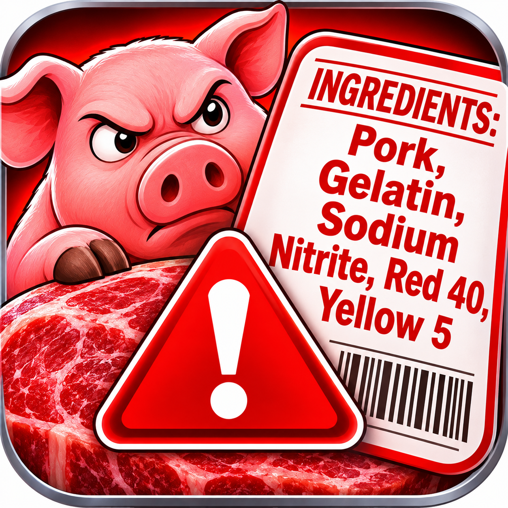

# Clean Food Scanner

An Android app that scans a food's barcode or ingredients label and flags anything from an animal
Scripture calls unclean (Leviticus 11, Deuteronomy 14), with the verse for each finding.

Scanning happens on the phone with Google ML Kit, so reading a barcode or label is near-instant and
label reading works offline. Barcodes are looked up in the free [Open Food Facts](https://world.openfoodfacts.org) database.

## What it checks

- **Unclean (red):** pork and its by-products, shellfish, fish without fins and scales, rabbit, horse,
  reptiles, unclean birds, insect colors (carmine, shellac). Blood is on by default (Lev 17; Acts 15);
  suet and tallow (Lev 3:17; 7:23) can be turned on.
- **Check the source (amber):** ingredients that are often from pork but may not be: gelatin,
  mono- and diglycerides, glycerin, enzymes, casings, natural flavors.
- **Personal observance (orange):** petroleum-based dyes (Red 40, Yellow 5…) and other petroleum
  additives (BHA, BHT, TBHQ, paraffin), each optional.
- **Allergens (purple):** pick from milk, eggs, fish, shellfish, peanuts, tree nuts, wheat, gluten, soy,
  sesame, corn, mustard and sulfites. "May contain" lines are flagged too.
- **Full kosher (optional):** adds rabbinic rules: meat with dairy, kosher slaughter, wine and cheese
  supervision. Certification checks are skipped when the package has a kosher symbol.

The rules live in [`Rules.kt`](app/src/main/java/com/mikefougnie/foodscanner/Rules.kt) and are tested in
[`CheckerTest.kt`](app/src/test/java/com/mikefougnie/foodscanner/CheckerTest.kt).

## Install

**Easiest:** open the repo's **Actions** tab, open the latest *Build APK* run, download
`CleanFoodScanner-debug-apk`, unzip it, and open the `.apk` on your phone (allow installs from your browser or files app).

**From source:** open the folder in Android Studio (Ladybug or newer), let Gradle sync, plug in your phone
with USB debugging on, and press Run.

## Limits

The app reads only what is printed. It can't see what a maker leaves off the label or what is shared on
factory equipment beyond the label's own warnings. For a serious allergy, always read the package yourself.
